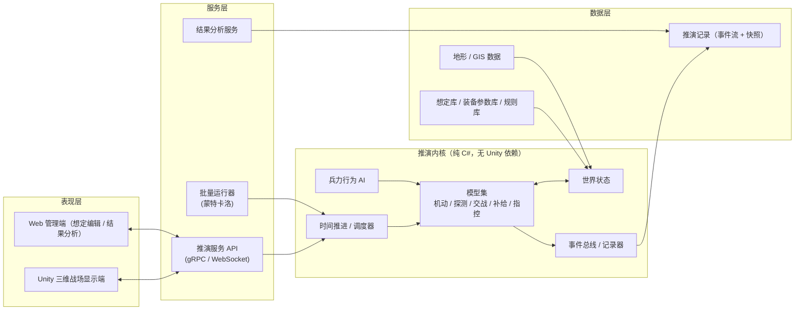

# XFramework 战场仿真推演系统 —— 总体架构设计

> 版本：v0.1（草案）
> 日期：2026-10-18
> 状态：讨论稿，随开发迭代更新

---

## 1. 项目目标

XFramework 是一套**构造式（Constructive）战场仿真推演系统**。用户给定一个特定的作战想定（兵力、地形、天候、补给、战术意图），系统综合战术、机动、侦察、火力、补给等因素进行推演，输出**推演结果及其可信区间**，并用 Unity 三维战场进行可视化展示和复盘。

### 1.1 核心能力

| 编号 | 能力 | 说明 |
|---|---|---|
| C1 | 想定编辑 | 定义双方（或多方）兵力编成、部署、任务、补给体系、环境条件 |
| C2 | 综合推演 | 机动、侦察探测、交战裁决、补给消耗与输送、指挥控制等模型联合运算 |
| C3 | 结果分析 | 胜负判定、战损、弹药/油料消耗、时间线、关键事件；支持蒙特卡洛多次运行得到概率分布 |
| C4 | 三维显示 | Unity 实时显示战场态势，支持回放、跳转、多视角 |
| C5 | 方案对比 | 同一想定下比较不同战术方案、补给方案的结果差异（敏感性分析） |
| C6 | 智能辅助（后期） | AI 生成想定、AI 扮演对抗方、AI 自动生成复盘报告 |

### 1.2 设计原则

1. **仿真与显示分离**：推演引擎不依赖 Unity，可以无界面（headless）运行。Unity 只是显示端和交互端之一。
2. **确定性可复现**：同一想定加同一随机种子，必须得到完全相同的结果。这是复盘、调试和结果可信的基础。
3. **数据驱动**：装备参数、毁伤概率、消耗标准、条令规则全部来自配置数据，不写死在代码里。
4. **模型可插拔**：交战裁决、机动、补给等模型都通过接口定义，可以替换为不同精度或不同算法的实现。
5. **先粗后细**：先以营/连为最小单位做聚合级推演，跑通整体流程后再细化。

### 1.3 不做什么（当前阶段）

- 不做单兵级、实体级的高保真物理仿真（例如弹道、飞行动力学）。
- 不使用任何涉密数据。默认数据集使用公开资料或虚构参数，真实参数由用户在部署环境中自行导入。
- 暂不对接 HLA/DIS 等外部仿真联邦，但接口设计保留扩展空间（见第 9 节）。

---

## 2. 总体架构



### 2.1 分层说明

| 层 | 职责 | 技术选型（建议） |
|---|---|---|
| 推演内核 | 世界状态、所有仿真模型、时间推进、事件记录 | C# / .NET 8，类库形式，可被 Unity 和服务端共同引用 |
| 服务层 | 对外提供推演控制、批量运行、结果查询 | ASP.NET Core + gRPC（控制）+ WebSocket（态势推送） |
| 表现层 | 三维显示、交互操作、想定编辑、报表 | Unity 6（三维）；Web 端可后期再做 |
| 数据层 | 想定、参数、记录、地形 | 想定和参数：JSON/YAML 文件 + SQLite；记录：二进制事件流（MessagePack） |

**选择 C# 做内核的理由**：Unity 本身使用 C#，内核代码和数据结构可以直接共享，单机模式下 Unity 可以直接内嵌内核运行，不需要服务器；需要多人、批量计算或接入 AI 时，再把同一个内核放到服务端运行。

### 2.2 两种运行模式

1. **单机模式**：Unity 直接引用内核 DLL，本地推演并显示。适合开发调试和单人演示。
2. **服务模式**：内核运行在服务端，Unity 和 Web 端作为客户端连接。适合多席位推演、蒙特卡洛批量运算和 AI 功能。

两种模式下内核代码完全相同。

---

## 3. 推演内核设计

### 3.1 世界状态（World State）

世界状态是推演在某一时刻的完整快照，所有模型只能通过它读写数据。

```
World
├── Time                 当前仿真时间
├── Environment          地形、天候、昼夜、能见度
├── Sides[]              参演方（红 / 蓝 / 其他），含情报视图
├── Units[]              作战单位（聚合级：营 / 连 / 排）
├── SupplyNodes[]        补给节点（仓库、补给点、野战补给站）
├── SupplyRoutes[]       补给线路（道路网上的路径）
├── Orders[]             当前生效的命令
└── RandomState          随机数状态（保证可复现）
```

### 3.2 作战单位模型

单位采用**聚合级**建模：一个单位代表一个建制分队，而不是单个士兵或单件装备。

| 属性组 | 主要字段 |
|---|---|
| 身份 | 编号、名称、所属方、上级单位、兵种类型 |
| 编成 | 装备清单（型号 × 数量）、人员数量 |
| 状态 | 位置、朝向、姿态（行军 / 展开 / 防御 / 隐蔽）、战斗力百分比、士气、疲劳度 |
| 补给 | 弹药（按类别）、油料、给养、携行量上限 |
| 感知 | 当前掌握的敌情（带置信度和时效），而非上帝视角 |
| 任务 | 当前命令、任务阶段 |

**战斗力**由装备完好数、人员、士气、疲劳、补给状态共同决定，是交战裁决的主要输入。

### 3.3 时间推进

采用**固定步长加离散事件的混合推进**：

- **固定步长**（例如 1 分钟仿真时间）：处理机动、探测、持续交战、补给消耗等连续过程。
- **离散事件**：处理命令下达、补给车队到达、单位被歼灭等瞬时事件，按时间排序插入队列。

每个步长内的处理顺序固定，以保证确定性：

```
1. 处理到期的离散事件
2. 指挥控制：AI / 人工命令生效
3. 探测与情报更新
4. 机动
5. 交战裁决
6. 补给消耗与输送
7. 状态更新（战斗力、士气、疲劳）
8. 胜负条件检查
9. 记录事件与快照
```

支持暂停、单步、倍速（1× 到最大速度）以及无界面全速运行。

### 3.4 模型集

所有模型都实现统一接口，便于替换：

```csharp
public interface ISimModel
{
    string Name { get; }
    void Initialize(World world, ModelConfig config);
    void Step(World world, SimTime dt, IEventSink events);
}
```

#### 3.4.1 地形与环境模型

- **地图表示**：第一阶段采用**六角格**（兵棋常用，便于计算通行和视线），后期支持基于高程图（DEM）的连续地形。
- **地形属性**：地形类型（平原、丘陵、山地、城镇、森林、水域）、高程、道路等级、桥梁。
- **影响**：机动速度修正、隐蔽 / 防护修正、通视。
- **环境**：昼夜、天候（雨、雾、雪）影响探测距离和机动速度。

#### 3.4.2 机动模型

- 基于道路网和地形通行代价的路径规划（A*）。
- 速度 = 单位基础速度 × 地形修正 × 天候修正 × 姿态修正 × 疲劳修正。
- 行军消耗油料，按装备类型和里程计算。
- 支持编队机动、道路拥堵（同一路段通行能力有限）。

#### 3.4.3 探测与情报模型

- 每一方维护**独立的情报视图**，只能看到自己探测到的敌方单位。
- 探测概率取决于：传感器类型和距离、目标姿态（隐蔽 / 运动）、地形遮蔽、天候和昼夜。
- 情报会过时：长时间未再次探测的目标，其位置置信度会逐步下降。
- 交战裁决、AI 决策都基于情报视图，而不是真实状态，这样推演才有“战争迷雾”。

#### 3.4.4 交战裁决模型

交战裁决是推演结果的核心。设计为**多精度可选**：

| 级别 | 方法 | 适用场景 |
|---|---|---|
| L1 | **兰彻斯特方程**（线性律 / 平方律）的离散化版本 | 快速评估、大规模批量推演 |
| L2 | **火力指数加毁伤表**：按武器类型、目标类型、距离查表得到命中率和毁伤率 | 常规推演（默认） |
| L3 | 武器对目标逐对计算（单发命中概率 × 毁伤概率） | 关键局部战斗的精细推演 |

**交战修正因素**：

- 地形防护（城镇、工事、反斜面）
- 姿态（进攻 / 防御 / 遭遇）
- 指挥协同（上级指挥所是否完好、通信是否畅通）
- 补给状态（弹药不足时火力下降，弹药耗尽无法射击）
- 士气和疲劳
- 战术行动修正（侧翼攻击、包围、火力准备）

**随机性**：裁决结果由带种子的随机数产生。单次推演给出一种可能结果，多次推演（第 5 节）给出概率分布。

#### 3.4.5 补给模型

补给是本系统重点考虑的综合因素之一。

**补给物资分类**（可配置）：弹药（按口径或类别细分）、油料、给养和饮水、器材和备件。

**补给体系**：

```
后方基地 ──干线──▶ 前进补给点 ──支线──▶ 野战补给站 ──▶ 作战单位
```

- **补给节点**：有库存、吞吐能力、防护能力，可以被攻击和摧毁。
- **补给线路**：沿道路网，运输能力受车辆数、道路状况、敌方威胁影响。
- **运输**：以车队为离散实体在路网上移动，可能被拦截。
- **消耗**：按单位状态计算消耗率（行军耗油、交战耗弹、驻止消耗给养）。
- **补给不足的后果**：
  - 弹药不足：火力系数下降。
  - 油料不足：机动速度下降甚至无法机动。
  - 给养不足：士气和疲劳恶化。

推演结果中应能清楚看到：**补给线被切断后，前线单位在多长时间后失去战斗力。**

#### 3.4.6 指挥控制模型

- **指挥层级**：单位隶属关系形成指挥树。
- **命令类型**：机动、进攻、防御、迟滞、撤退、侦察、补给、待命。
- **命令延迟**：命令从下达到执行有时间延迟，取决于通信状态和指挥层级。
- **指挥所受损**：下级单位反应变慢、协同修正下降。

### 3.5 兵力行为 AI

单位需要在没有人工指令时自主行动，并让推演中的“对手”具备合理战术。

| 阶段 | 方法 | 说明 |
|---|---|---|
| 第一阶段 | **行为树** | 实现基础战术行为：遇敌展开、火力不足时请求支援、弹药低于阈值时请求补给、战斗力低于阈值时撤退 |
| 第二阶段 | **分层任务网络（HTN）** | 把上级意图（如“夺取某高地”）分解为下级的具体任务序列 |
| 第三阶段 | **大模型辅助** | 根据想定生成作战方案、扮演对抗方指挥员、生成复盘报告（见第 7 节） |

战术规则（条令）以数据形式描述，例如“进攻时兵力比低于 3:1 则不发起攻击”，便于不同用户按自己的条令进行调整。

### 3.6 事件总线与记录

- 内核中所有状态变化都以**事件**形式发出，例如单位移动、发现目标、交战、毁伤、补给到达、命令下达。
- 记录器将事件流持久化，并每隔固定时间保存一次完整快照。
- **回放**：从最近的快照开始重放事件，即可跳转到任意时刻。
- Unity 显示端也通过订阅事件流来更新画面。

---

## 4. 想定（Scenario）

### 4.1 想定内容

```
Scenario
├── 元信息：名称、描述、作者、版本
├── 环境：地图、起止时间、天候变化计划
├── 参演方：名称、阵营关系、胜利条件
├── 兵力编成：单位树、装备、初始部署、初始补给
├── 补给体系：节点、线路、库存
├── 初始命令 / 作战计划
├── 脚本事件：在某时刻或满足某条件时触发（例如增援到达、天气突变）
└── 推演参数：时间步长、交战模型级别、随机种子
```

### 4.2 格式

- 使用 **JSON 格式**存储，并配有 JSON Schema 校验。
- 装备参数、毁伤表、消耗标准存放在独立的**参数库**中，想定只按编号引用，方便多个想定共享同一套参数。

---

## 5. 推演结果与分析

这是系统“在特定情况下给出推演结果”这一目标的直接体现。

### 5.1 单次推演结果

- **胜负判定**：依据想定中定义的胜利条件（占领目标、歼敌比例、守住时间等）。
- **战损统计**：双方人员、装备损失，按时间、单位、原因分类。
- **补给统计**：各类物资的消耗曲线、库存曲线、断供时刻。
- **时间线**：关键事件列表（首次接敌、突破防线、补给线被切断等）。
- **态势回放**：交给 Unity 显示。

### 5.2 蒙特卡洛批量推演

由于交战和探测含随机因素，单次结果不能代表一般情况。批量运行器会：

1. 用不同随机种子将同一想定运行 N 次（例如 500 次），可多核并行。
2. 汇总得到：
   - 胜率及其置信区间
   - 战损、消耗、所需时间的分布（均值、中位数、P10 / P90）
   - 结果对关键事件的依赖程度（例如“补给线在第 6 小时前被切断时，胜率从 70% 降到 25%”）

### 5.3 方案对比与敏感性分析

- 同一想定下切换不同战术方案或补给方案，各自进行批量推演，对比结果分布。
- 对某个参数（如补给车辆数量、增援到达时间）在一定范围内扫描，找出结果的转折点。

---

## 6. Unity 三维战场显示端

### 6.1 职责

Unity 只负责**显示和交互**，不负责任何裁决计算。

| 功能 | 说明 |
|---|---|
| 三维地形 | 由高程数据和影像生成地形，叠加六角格或网格（可开关） |
| 单位显示 | 三维模型和军标（军队标号）两种显示方式，可切换 |
| 态势图层 | 双方情报视图切换、上帝视角、补给线、火力范围、探测范围、控制区 |
| 事件特效 | 交战、毁伤、补给到达等事件的视觉表现 |
| 时间控制 | 播放、暂停、倍速、时间轴拖动 |
| 交互 | 选中单位查看状态、下达命令（服务模式或单机模式） |
| 回放 | 加载推演记录进行复盘 |

### 6.2 与内核的通信

```
内核 ──(事件流 + 定期快照)──▶ Unity
Unity ──(命令、时间控制)──▶ 内核
```

- **单机模式**：直接进程内调用。
- **服务模式**：WebSocket 推送态势，gRPC 发送控制指令；数据格式统一用 MessagePack 序列化。
- Unity 端对单位位置做**插值平滑**：内核按 1 分钟步长更新，画面仍然流畅。

### 6.3 Unity 工程结构（建议）

```
UnityClient/
├── Assets/
│   ├── Scripts/
│   │   ├── Bridge/        与内核通信（单机 / 网络两种适配器）
│   │   ├── Terrain/       地形加载与网格叠加
│   │   ├── Units/         单位显示、军标、插值
│   │   ├── Layers/        各类态势图层
│   │   ├── Effects/       事件特效
│   │   ├── UI/            时间轴、单位面板、命令面板
│   │   └── Replay/        回放控制
│   ├── Models/            三维模型资源
│   └── Symbols/           军标资源
└── Packages/
    └── XFramework.Core    引用推演内核
```

---

## 7. 智能辅助（后期）

| 功能 | 输入 | 输出 |
|---|---|---|
| 想定生成 | 自然语言描述的作战背景 | 初始想定草稿（兵力、部署、任务），供人工修改 |
| 方案生成 | 想定和作战意图 | 若干候选作战方案，可直接进入批量推演对比 |
| AI 对抗方 | 实时情报视图 | 对抗方的指挥决策 |
| 自动复盘 | 推演记录和统计结果 | 文字复盘报告：关键转折点、失误分析、改进建议 |

**原则**：大模型只负责“提出方案”和“解释结果”，**裁决计算始终由确定性模型完成**，保证结果可复现、可追溯。

---

## 8. 代码仓库结构（建议）

```
XFramework/
├── docs/                         设计文档
├── src/
│   ├── XFramework.Core/          推演内核：世界状态、调度器、事件
│   ├── XFramework.Models/        机动、探测、交战、补给、指控模型
│   ├── XFramework.AI/            行为树、HTN
│   ├── XFramework.Scenario/      想定加载、校验
│   ├── XFramework.Analysis/      统计与对比分析
│   ├── XFramework.Server/        推演服务（gRPC / WebSocket）
│   └── XFramework.Cli/           命令行工具：无界面推演、批量运行
├── tests/                        单元测试、确定性回归测试
├── data/
│   ├── parameters/               参数库（示例数据为虚构参数）
│   └── scenarios/                示例想定
└── UnityClient/                  Unity 显示端工程
```

---

## 9. 扩展与标准

预留以下扩展点，暂不实现：

- **HLA（IEEE 1516）/ DIS（IEEE 1278）**：与其他仿真系统组成联邦。
- **MSDL / C-BML（SISO 标准）**：想定和命令的标准化交换格式。
- **GIS 数据**：导入 GeoTIFF 高程、矢量道路网。
- **插件化模型**：第三方以 DLL 形式提供新的交战或补给模型。

---

## 10. 开发路线图

| 阶段 | 目标 | 主要内容 | 验收标准 |
|---|---|---|---|
| **M0 骨架** | 跑通最小闭环 | 内核骨架、六角格地图、单位、机动、L1 兰彻斯特交战、命令行运行 | 命令行跑完一个双方各 3 个单位的想定，输出结果；同一种子两次结果完全一致 |
| **M1 补给** | 综合因素推演 | 补给节点 / 线路 / 车队、消耗模型、补给不足对战斗力的影响 | 示例想定中切断补给线后，前线单位战斗力按预期下降 |
| **M2 显示** | 三维可视化 | Unity 单机模式：地形、单位、时间控制、回放 | 在 Unity 中完整回放 M1 想定 |
| **M3 结果分析** | 给出推演结论 | 探测与情报视图、L2 交战模型、蒙特卡洛批量运行、统计报表 | 对一个想定运行 500 次，输出胜率和战损分布 |
| **M4 智能行为** | 自主推演 | 行为树 AI、条令规则配置、方案对比 | 无人工干预下双方 AI 完成一场推演，结果合理 |
| **M5 服务化** | 多席位 | 推演服务、网络通信、多客户端 | 两个 Unity 客户端分别指挥红蓝双方 |
| **M6 智能辅助** | AI 增强 | 想定生成、自动复盘报告 | 用自然语言生成可运行的想定 |

---

## 11. 关键风险

| 风险 | 说明 | 应对 |
|---|---|---|
| 模型可信度 | 推演结果取决于模型和参数，参数不准，结论就不可信 | 模型和参数分离；提供校核验证（VV&A）工具，用历史战例回放对比 |
| 范围过大 | “一整套”系统容易无限扩张 | 严格按路线图推进，每个阶段都有可运行的成果 |
| 性能 | 蒙特卡洛批量运行计算量大 | 内核无界面运行、多核并行；聚合级建模控制计算规模 |
| 资质与合规 | 军事领域销售通常需要相应资质，部分技术和数据受出口管制 | 产品本身只含公开或虚构数据；商业化前确认资质要求，可考虑与有资质的单位合作，或先面向教学科研市场 |

---

## 附录 A：国内外同类平台参考

| 平台 | 开发方 | 类型 | 说明 |
|---|---|---|---|
| Command: Modern Operations (CMO) | Matrix Games / Slitherine | 海空为主的作战推演 | 有商业版和面向机构的专业版，民用市场可购买 |
| VBS4 | Bohemia Interactive Simulations | 虚拟训练仿真 | 偏单兵和战术级训练，三维表现强 |
| SWORD | MASA Group（法国） | 构造式仿真 | 聚合级单位，基于条令的自主行为，与本项目定位最接近 |
| JTLS-GO | Rolands & Associates | 联合战区级仿真 | 包含较完整的后勤模型 |
| AFSIM | 美国空军研究实验室 | 任务级仿真框架 | 仅向美国及盟友政府和承包商提供 |
| OneSAF | 美国陆军 | 半自主兵力生成 | 仅限政府使用 |
| Darwin | LGNDX | 浏览器端推演 | 2026 年发布，基于物理模型的蒙特卡洛推演，可快速生成定量复盘分析 |
| WarMatrix | Code Metal / 美国空军 | AI 兵棋推演 | 2026 年投入使用 |
| 战略战役兵棋系统 | 国防大学联合作战学院 | 战略战役级兵棋 | 国内军用 |
| 庙算 | 中国科学院自动化研究所 | 智能兵棋推演 | 融合 AI 对战模型 |
| 墨子·未来指挥官 | 华戍防务 | 联合作战推演 | 有面向院校和爱好者的版本 |

**参考标准**：T/CICC 31006—2025《智能兵棋推演系统设计要求》（中国指挥与控制学会，2025 年 11 月）。

**开源参考**：目前没有找到成熟的、同时包含交战和补给的开源推演引擎，现有的多是兰彻斯特方程演示或概念验证项目。这也说明本项目的推演内核有独立价值。
