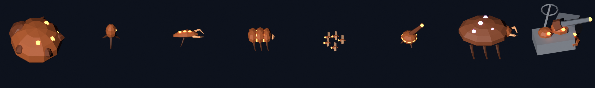

# 美术方向与舰船模型

界面稿和造型图在设计画布上：[星线 美术与界面设计](https://claude.ai/artifact/43WiNNPkBcqsKzZCwcpq29)。这里记录定下来的规则和模型的制作流程。

## 1. 风格：冷光战术终端

低多边形舰船 + 深色战术界面。

| 原则 | 说明 |
|---|---|
| 剪影先于细节 | 平直着色、无法线贴图。每个舰种靠一个夸张的特征认出来（战列舰的双主炮、导弹舰的背负弹舱、点防御舰的三座球形炮塔） |
| 颜色就是阵营 | 晨星舰队：白灰装甲 + 蓝色发光条；蜂群：深橙甲壳 + 亮橙脉络；虚空行者：紫色（第三幕）。界面、血条、模型发光用同一套颜色 |
| 补给是光 | 补给线和信标是画面里最亮的青绿色；断补给的舰船发光条变暗并闪红 |

## 2. 色板

与 `Theme.uss` 和 `ViewUtil` 一致。

| 用途 | 颜色 |
|---|---|
| 背景 / 面板 / 凸起面板 | #0B111B / #121A27 / #1A2536 |
| 文字 / 次要文字 | #E3E9F2 / #93A1B5 |
| 晨星舰队 | #5AB8FF |
| 蜂群 | #FF8F4A |
| 补给网络 | #6FD0B4（3D 场景和界面统一用这个青绿色） |
| 推演、隐藏特性 | #C48CFF |
| 精英、离网倒计时 | #E8C15A |
| 断补给、危险 | #FF6B6B |
| 胜利、增益 | #6FD08C |

字体：中文用 Noto Sans SC（已随包）；数字和英文标题建议加 Rajdhani（SIL OFL）。

## 3. 界面

- 按 3840 × 2160（4K）设计，按屏幕高度缩放（见 [client-architecture.md](client-architecture.md) 第 3 节）。
- 六个界面的布局见设计画布：主菜单、星图、布阵、战斗、战利品、远征结算。

## 4. 舰船模型

### 规格

| 项目 | 规定 |
|---|---|
| 尺寸 | 1 格 = 2 个 Unity 单位。1 格舰船长约 1.6，2×2 舰船长约 3.6 |
| 朝向 | 船首朝 Unity 的 +Z（Blender 的 -Y），轴心在底面中心；舰船悬浮在离地约 0.5 处，舰载机群和飞蝗群的高度由客户端另加 |
| 面数 | 小型 200~500 三角面，大型 500~700（当前生成结果） |
| 材质 | 两个材质槽：Hull 用共享色块贴图 `Palette.png`（8 × 8 格），Glow 是发光部位，颜色由客户端设置 |
| 星级 | 体型每星放大 12%（已有代码）；★2/★3 加部件以后再做 |

### 发光状态（客户端 `UnitView`）

| 状态 | 发光部位 |
|---|---|
| 接入补给 | 阵营色常亮（补给母舰和中继信标为青绿色，母体为紫色） |
| 断补给 | 暗红色慢闪 |
| 舰载机离网倒计时 | 黄色快闪 |
| 受击 | 舰体闪白 |

### 制作流程：脚本生成

模型由 `tools/models/build_models.py` 用 Blender 生成，每个单位一个函数，用放样、方块、低面数球体、圆锥拼出来。

```
blender --background --python tools/models/build_models.py -- --preview docs/art/models
```

也可以用 `pip install bpy` 装好的 Python 模块直接运行 `python3 tools/models/build_models.py --preview docs/art/models`。

- 输出：`Starline/Packages/com.starline.game/Runtime/Resources/StarlineModels/<单位 id>.fbx` 和 `Palette.png`；加了 `--preview` 时还会渲染预览图到 `docs/art/models/`。
- 客户端按单位 id 加载模型（`ModelLibrary`），某个单位没有模型时自动退回原来的几何体占位。
- 新增单位：在脚本里加一个函数并登记到 `UNITS`，重新运行即可。也可以在 Blender 里打开导出的 FBX 手工修改，但下次运行脚本会覆盖同名文件。

当前预览：



