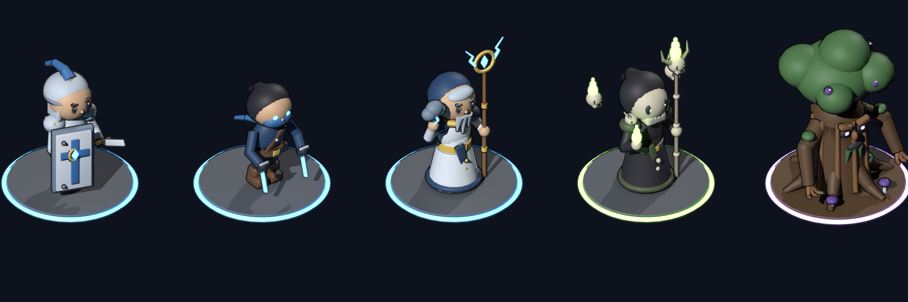
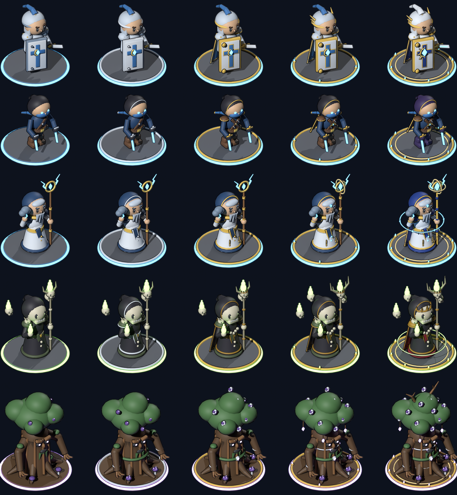
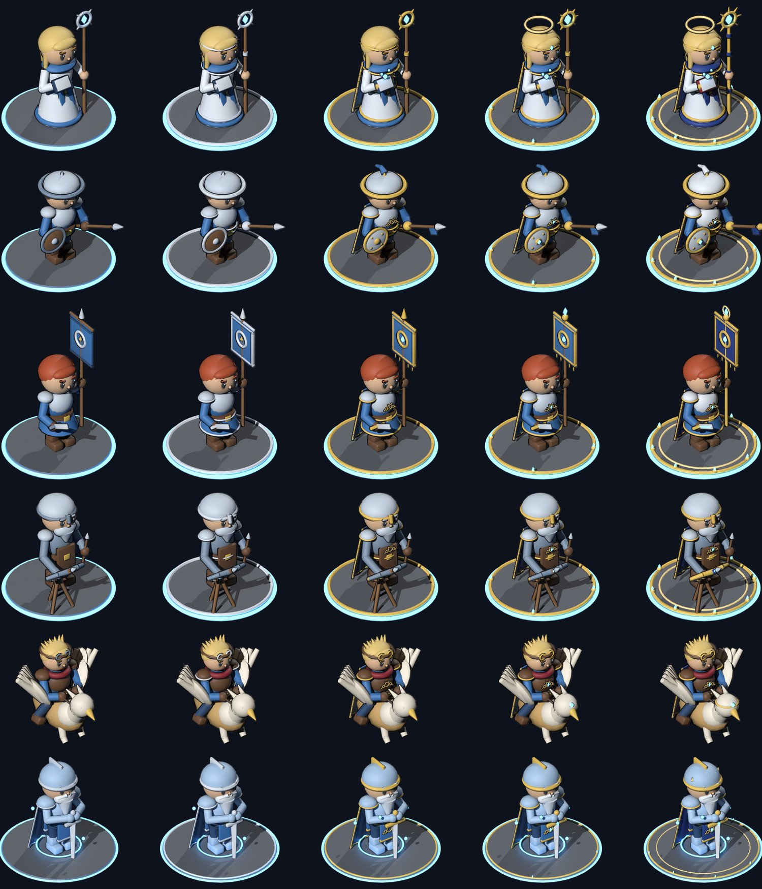
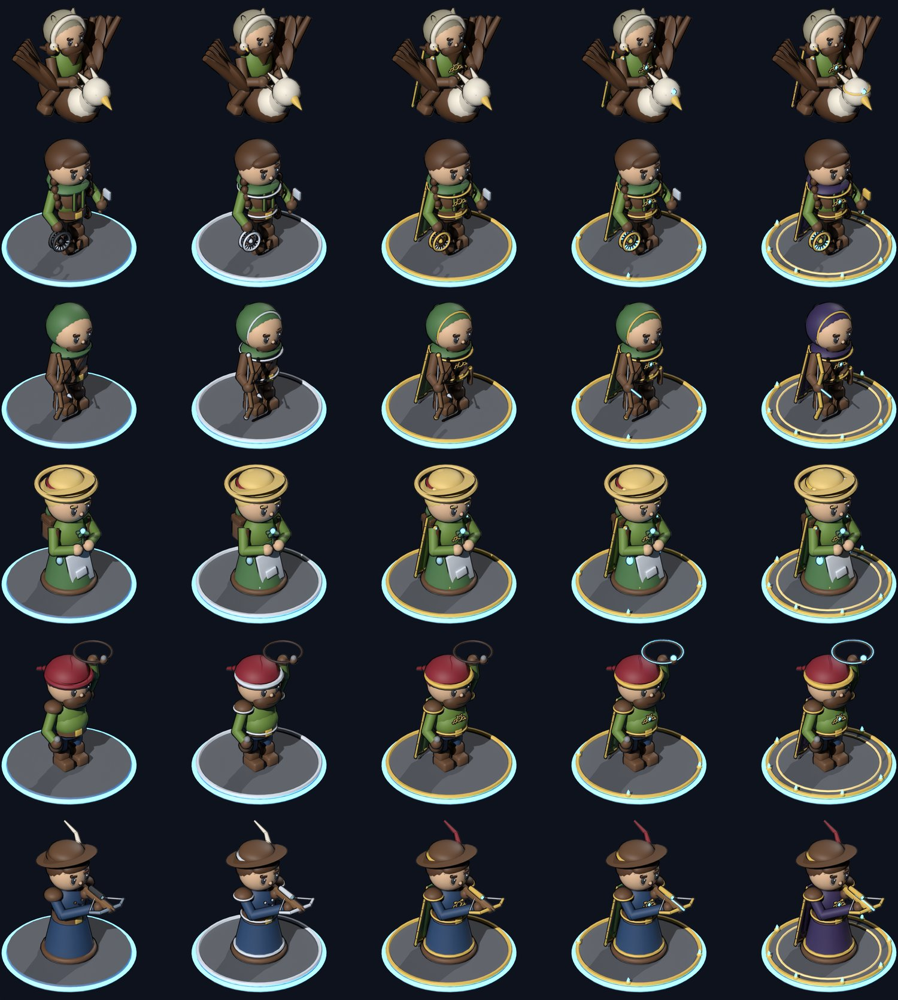
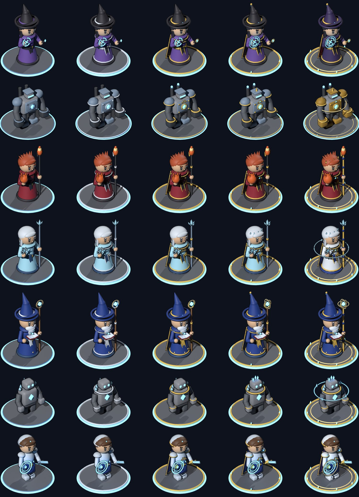
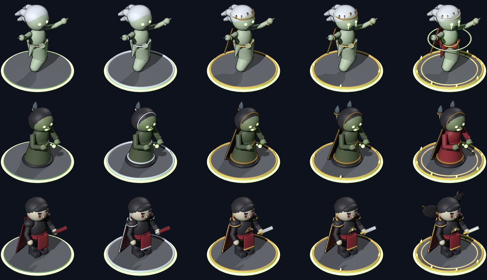
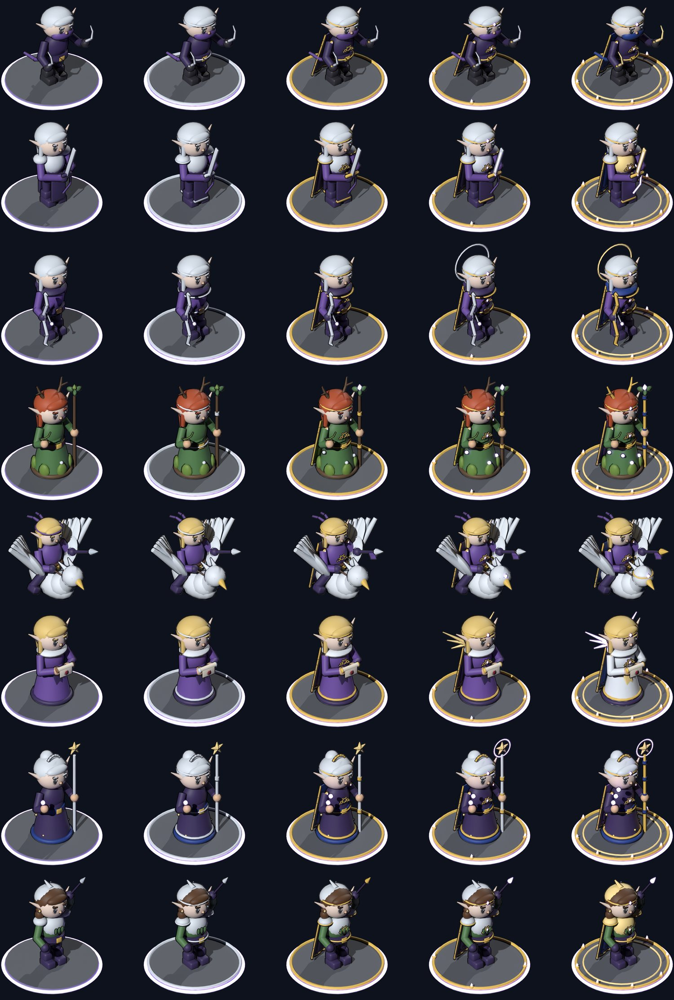
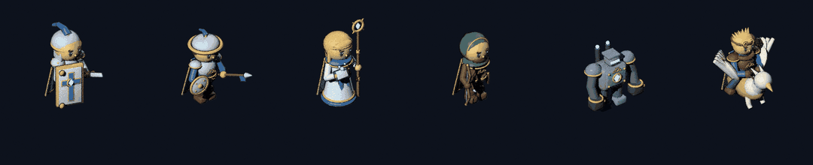
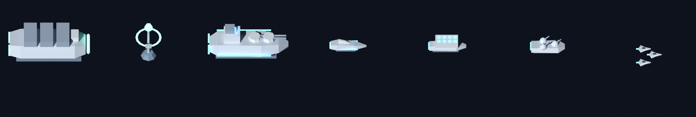
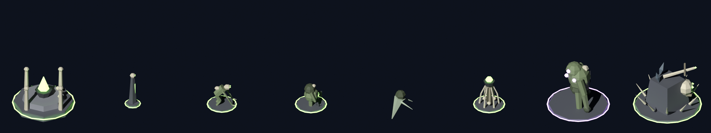

# 美术方向与角色模型

题材是奇幻“魔网”（见 [game-design.md](game-design.md) 第 2、13 节和附录的术语对照）。这里记录美术规则和模型的制作流程。界面稿在设计画布上：[星线 美术与界面设计](https://claude.ai/artifact/43WiNNPkBcqsKzZCwcpq29)。

## 1. 风格：桌面战棋 + 魔网光带

低多边形、平直着色的奇幻角色，每个角色是一枚摆在桌上的战棋棋子；魔网是画面里最亮的光。

| 原则 | 说明 |
|---|---|
| 剪影先于细节 | 战斗镜头里一名角色只有几十像素高，每个兵种要靠一个夸张的特征认出来：重甲骑士的骑枪和战马、游侠的兜帽和长弓、奥术法师的尖帽和法杖水晶、弩手斜指天空的弩 |
| 颜色就是阵营 | 晨星远征军：白钢 + 蓝色布料，发光是蓝色魔法；亡灵：灰绿腐肉 + 骨白，发光是幽绿色；影歌精灵：紫色（第三幕） |
| 魔网是光 | 法力水晶、源晶塔和魔网连线是最亮的青绿色。每名角色脚下都有一圈发光环（卡通角色在战斗里没有底座，是地面上的一圈光环），接入魔网时常亮，断开时变暗闪红 |

## 2. 色板

界面色与 `Theme.uss` 和 `ViewUtil` 一致。界面上的敌我对比仍用蓝 / 橙（血条、阵营标签），亮度差大，色弱玩家也能分清；模型自身用各阵营的材质颜色。

| 用途 | 颜色 |
|---|---|
| 夜空背景 / 面板 / 凸起面板 | #0A1020 / #111A2E / #18233B |
| 金边 / 亮金（标题） / 主按钮 / 主按钮文字 | #B8954F / #E8C77A / #D9B46A / #1A1408 |
| 文字 / 次要文字 | #EDE6D6 / #9AA5B8 |
| 晨星远征军（界面、模型发光） | #5AB8FF |
| 亡灵（界面） | #FF8F4A |
| 亡灵（模型发光） | #8EE06A |
| 魔网，也是界面的选中态和进度条 | #6FD0B4（3D 场景和界面统一） |
| 推演、隐藏特性 | #C48CFF |
| 精英、离网倒计时 | #E8C15A |
| 断开魔网、危险 | #FF6B6B |
| 胜利、增益 | #6FD08C |

模型材质色（`Palette.png`）：白钢 #C9D5E3、蓝布 #3E78B8、深蓝布 #2A4870、皮革 #6B4A32、木 #8A6440、石 #8C8F96、骨白 #D8D2BC、腐肉 #7E8F6A、怨灵 #B8C9B0 等，完整列表见脚本里的 `PALETTE`。

## 3. 界面：星夜金边

- 按 3840 × 2160（4K）设计，按屏幕高度缩放（见 [client-architecture.md](client-architecture.md) 第 3 节）。六个界面的布局见设计画布：主菜单、地图、布阵、战斗、战利品、远征结算。
- 面板：深蓝底 + 一像素金线，圆角很小，设计稿里四角各有一颗小菱形。不做浮雕、羊皮纸和花纹。
- 标题：界面名、单位名、节点名用亮金色；主按钮金底深色字；次按钮透明底金边金字。
- 魔网青绿用作分隔光带、选中态、法术点数和地图上走过的路；可前往的路是金色。
- 字体：正文和数字用 Noto Sans SC（已随包）。设计稿的标题用思源宋体（Noto Serif SC），标志用 Cinzel，两者都是 SIL OFL；还没放进工程，客户端暂时用黑体粗体加金色代替。完整的思源宋体约 10 MB 以上，放进来时考虑只放 Bold 一个字重，或按游戏里实际用到的字裁剪。

## 4. 角色模型

### 第一幕的 15 个单位

| 单位（id） | 造型 | 识别特征 |
|---|---|---|
| 源晶塔（supply_ship） | 2×2 石塔，塔顶悬浮巨大水晶和符文环 | 正面的发光拱环是源口 |
| 法力水晶（relay） | 石座上悬浮的双锥水晶，三片碎晶环绕 | 发光核心 |
| 重甲骑士（battleship） | 2×2 底座上一名骑白马、披蓝马衣的骑士 | 长骑枪 |
| 游侠（frigate） | 一名兜帽弓手 | 兜帽和长弓 |
| 奥术法师（missile_ship） | 一名穿长袍、戴尖帽的法师 | 法杖顶端的水晶和环绕的法力球（表示剩余法力） |
| 弩手（pd_ship） | 一名戴盔弩手，身前立着大盾 | 弩斜指天空 |
| 狮鹫骑士（strike_craft） | 一名骑狮鹫的骑士，悬空 | 展开的翅膀 |
| 亡灵祭坛（hive） | 2×2 两层石台，四角骨柱，中央铁火盆燃着幽绿火焰 | 绿色火柱 |
| 骨碑（hive_node） | 方尖石碑，顶上一颗骷髅 | 碑面发光符文 |
| 食尸鬼（ripper） | 一个佝偻的瘦长身影 | 长臂利爪 |
| 憎恶（crawler） | 一个缝合的肥胖巨躯 | 屠刀和铁钩 |
| 怨灵（locust） | 一个漂浮的兜帽幽魂，下身拖成尖尾 | 发光的脸 |
| 毒雾骨塔（acid_turret） | 肋骨围成的骨笼，顶上铁锅托着毒雾球 | 绿色毒球 |
| 缝合巨怪（brood_mother） | 2×2 佝偻的缝合巨人，长臂拖地 | 背上的光斑（隐藏特性，显示为紫色） |
| 骸骨要塞（wreck_fortress） | 2×2 骨刺环绕的石堡，正面巨大头骨，顶上架着骨弩，夹着熄灭的碎水晶 | 头骨和骨弩 |

### 第二批角色（8.3 节名单，样品）：圆润卡通风格

45 名角色里原有 35 名没有模型。先每个阵营做一名样品确认风格，确认后按阵营补齐了其余 30 名（见下面“补齐的 30 名角色”）。模型 id 用职业的英文名；这些角色进 `units.json` 时沿用同一个 id，客户端就能直接加载到模型。

开发者看过第一版低多边形样品后要求“不要那么多边形感，卡通一点，但要看得到细节”，所以第二批改成**圆润卡通**：

| 项目 | 规定 |
|---|---|
| 造型 | 头身比约 1:3，大头、大眼睛（带高光）、小鼻子、粗眉毛；手是圆球，靴子和盾牌是圆角方块 |
| 细节 | 用小零件补：铆钉、金色滚边和扣环、腰带、羽饰、骨刺领、苔藓蘑菇等 |
| 着色 | 平滑着色，折角大于 50° 的边保持硬边；仍然是 Hull 和 Glow 两个材质槽 |
| 贴图 | 每名角色单独展开 UV，把“色块颜色 × 环境光遮蔽（AO）”烘焙进专属贴图 `<模型 id>_tex.png`（768 × 791），缝隙和叠压处自然变暗；客户端发现这张贴图就用它 |
| 描边 | 反向外壳：沿法线外扩 0.012、翻转朝向的深色网格（#1C1A26），Unity 默认剔除背面，只在轮廓处露出一圈线，不需要专门的着色器 |
| 面数 | 含描边外壳每名角色约 1 万~2.6 万个三角面（★5 最多；脚本里的 `SEG` 控制圆周分段） |

| 角色 | 阵营 | 模型 id | 造型 | 识别特征 |
|---|---|---|---|---|
| 布兰 · 盾卫 | 晨星骑士团 | shield_guard | 戴开面盔、蓝色羽饰的骑士，钢甲配蓝罩袍，右手短剑 | 身前金边白底的塔盾，蓝十字中央一颗水晶 |
| 夜莺 · 影刃刺客 | 边境游侠会 | shadow_assassin | 前倾的兜帽身影，蓝面巾、斜挎皮带、腰包 | 发光的眼睛和双手反握的发光匕首 |
| 泽恩 · 风暴法师 | 银月法师塔 | storm_mage | 白袍深蓝饰边、金色高立领、白胡子 | 金环法杖上跳着闪电，左手托着一团雷云 |
| 维克多 · 死灵法师 | 亡灵 | necromancer | 骷髅头、尖兜帽、黑袍、骨刺领、骷髅肩甲 | 长角的骷髅法杖燃着绿火，身边飘着两颗绿火骷髅 |
| 老橡 · 树人守卫 | 影歌精灵 | treant_guard | 粗树干身躯带树皮棱，树根扎进底座，苔藓和紫蘑菇 | 茂密的树冠开着紫花，紫色眼光 |

第一幕的 15 个单位暂时保持低多边形；卡通风格确认后再决定要不要按同样的方法重做。影歌精灵的模型发光色暂定 #B48CFF（比推演、隐藏特性用的 #C48CFF 偏蓝一点）。新增材质色：黑袍 #2B2A33、树皮 #5E4630、树叶 #4F7A4A、精灵紫 #6A4C9C、深紫 #3A2D5C。



### 升星外观（决策 45）

升星不换造型，只让服装和装备一档比一档华丽。每名卡通角色每个星级一档模型：`<id>`（★1）、`<id>_s2` … `<id>_s5`，各带自己的贴图（768 × 791）。客户端 `ModelLibrary.ModelKey` 按星级挑最高的一档。

| 档位 | 服装 | 底座 |
|---|---|---|
| ★1 朴素 | 铁、皮革、素色布料 | 石底座 + 魔网发光环 |
| ★2 | 银色滚边和扣件、银铆钉 | 加一圈银边 |
| ★3 精锐 | 金色滚边、刺绣纹样、披风或交叉皮带、宝石扣、装备包金 | 银边换金边 |
| ★4 | ★3 上提前加一部分传说元素：金翼、宝石徽章、短披风、更大的宝石、发光果实 | 金边镶 4 颗发光宝石 |
| ★5 传说 | 换华贵配色（白金甲、深蓝 / 深红外袍、紫黑披风）、多层饰边、发光宝石镶嵌，招牌装备最华丽（日轮盾、符文环、金冠、满树花冠和枝角） | 加一道内圈，镶 8 颗 |



### 补齐的 30 名角色

和样品同一套做法：每名五档模型，升星规则见上表。共用零件在 `build_models.py` 里：发型 `hair`（短发、长发、马尾、丸子头、刺猬头）、精灵耳 `ears`、胡子 `beard`、头饰 `circlet`、兜帽 `hood`、尖顶法师帽 `mage_hat`，武器 `sword` / `bow` / `staff` / `spear` / `curved_blade`，按星级换装的 `dress`（★2 银饰边、★3 胸前刺绣和披风、★4 宝石、★5 换华贵色），飞行坐骑 `bird`（狮鹫或巨鹰）和骑手 `seated`。飞骑没有底座，轴心在模型底部，高度由客户端另加；2×2 角色底座半径 1.6、整体放大 1.9 倍。

| 阵营 | 角色（模型 id） | 识别特征 |
|---|---|---|
| 晨星骑士团 | 艾琳 · 牧师（priest） | 白袍蓝圣带、金色长发，日轮法杖和圣典；★4 起头顶光环 |
| | 塞德里克 · 长枪手（lancer） | 宽檐铁盔、胸甲，长枪斜指前方，左臂小圆盾；★3 起枪头燕尾旗 |
| | 奥莉薇亚 · 旗手（banner_bearer） | 红发马尾，高举骑士团战旗；旗面饰边、金穗、旗顶宝石逐档增加 |
| | 哈罗德 · 弩炮手（ballista） | 白胡子老兵、护鼻铁盔，身前一架仰射的三脚守城弩 |
| | 菲恩 · 狮鹫侍从（griffin_squire，飞骑） | 骑小狮鹫的少年，刺猬头、飞行护目镜、红围巾 |
| | 雷恩爵士 · 英灵（spirit_knight，2×2） | 淡蓝铠甲的老骑士，白胡子，双手拄大剑，脚下光环和光点 |
| 边境游侠会 | 托恩 · 驯兽师（beast_tamer，飞骑） | 骑褐色巨鹰的大胡子，毛皮兽耳兜帽，肩上停着小鹰 |
| | 贝丝 · 陷阱师（trapper） | 双麻花辫、皮背心，左手提张开的捕兽夹，右手小斧 |
| | 格雷 · 猎人（hunter） | 绿兜帽、胡茬，长弓搭箭，背箭筒；★4 起箭羽发光 |
| | 小麦 · 草药师（herbalist） | 草帽丸子头、白围裙，背大药草包，双手捧发光药草 |
| | 杜克 · 投石手（slinger） | 红头巾、圆肚子，头顶甩着一圈投石索，腰挂石袋 |
| | 约翰 · 神射手（marksman） | 插羽宽檐帽、长风衣，肩扛带瞄准镜的长弩 |
| 银月法师塔 | 莫娜 · 咒术师（hexer） | 紫袍黑尖帽、黑长发，左手悬着断开的发光咒印 |
| | 铁砧 · 攻城魔像（siege_golem，2×2） | 石身铁甲、胸口法力核心、一条发光眼缝，巨大铁拳；★5 暗金甲 |
| | 欧文 · 炎术士（pyromancer） | 红袍、火红刺猬头，左手托火球，火焰法杖 |
| | 苏菲 · 冰霜法师（frost_mage） | 冰蓝长袍、银白长发，冰晶法杖，手上一枚雪花；★4 冰晶冠 |
| | 阿尔德 · 大法师（archmage） | 深蓝高尖帽、长白胡，悬浮的法典，法杖顶法力球绕着 1~3 道金环 |
| | 微光 · 水晶傀儡（crystal_golem） | 石块拼成的小傀儡，背上肩上长冰蓝水晶，胸口发光核心 |
| | 卡兰 · 秘法骑士（spell_knight） | 钢甲刻发光符文，冰蓝剑刃，左手一面发光法盾 |
| 亡灵 | 赛薇 · 女妖（banshee） | 没有腿、拖着幽魂尾巴，白发向后飞扬，张口尖啸、双臂张开 |
| | 卡斯 · 吸魔者（mana_leech） | 佝偻的腐皮亡灵法师，背上导管连着吸来的法力水晶 |
| | 瓦伦 · 血族骑士（blood_knight） | 苍白脸、黑背头、红眼，黑甲深红披风，蝠翼高领和细长刀；★5 背后蝠翼 |
| 影歌精灵 | 希尔瓦 · 影舞者（shadow_dancer） | 面纱、银发高马尾，前倾双持弯刃，腰间飘带 |
| | 塞伦 · 影歌剑士（blade_singer） | 银白长发、紫色轻甲长摆，双手持长刃，身边绕着剑气 |
| | 莉安 · 月光射手（moon_archer） | 银发、兜帽垂肩，新月形银弓，发光箭头 |
| | 卡蕾 · 德鲁伊（druid） | 鹿角头冠、叶片长袍，藤蔓法杖，身边开花 |
| | 埃兰 · 风鹰骑手（wind_rider，飞骑） | 骑白色风鹰的精灵，发带飘扬，手持长枪 |
| | 维拉 · 使者（envoy） | 紫色长裙、金色长发，双手捧盟约卷轴；★4 起背后光翼 |
| | 伊娜 · 星语者（star_speaker） | 星纹深色长袍、新月头饰，五角星法杖，手边漂浮星光 |
| | 法埃 · 林间哨兵（sentinel） | 叶纹银甲半盔，举标枪朝天，肩上停着猫头鹰 |

新增材质色：精灵肤色 #F0D9CC、棕发 #5A3A22、金发 #E6C77A、红发 #B5502E、英灵淡蓝 #A9C7E8、火焰 #E0662A、冰蓝 #A8DDF2、苔绿 #6E8F3E。

各阵营的五档对比图（每行一名角色，从左到右 ★1 到 ★5）：







### 骨骼动画和底座（决策 46）

卡通角色带骨骼和动画导出，战斗里不放底座。

- **骨骼**：建模时登记骨骼，所有角色用同一套名字：`root`（脚底中心，整体位移和倒下）、`hips`、`spine`、`head`、`leg.R/L`、`arm_upper.R/L`、`arm_lower.R/L`、`cape`（披风）；飞骑另有 `mount`（坐骑身体）、`mount_head`、`mount_tail`、`wing.R/L`，骑手的 `hips` 挂在 `mount` 上。魔像和树人也用同名骨骼，只是比例不同
- **绑定**：卡通角色是一块块零件拼的，每块零件整块绑到离它最近的骨骼（刚性绑定，没有权重过渡）；武器自动绑在拿着它的那只手上，披风绑 `cape`，翅膀绑 `wing`。描边外壳跟着原来的零件动
- **动画**（24 帧每秒，FBX 里的动画名是 `<模型 id>_rig|<动画>`）：

| 动画 | 长度 | 内容 |
|---|---|---|
| idle | 2 秒循环 | 轻微起伏、歪头、披风飘；飞骑扇翅膀 |
| walk | 0.67 秒循环 | 迈腿摆臂、一颠一颠、前倾；长袍角色扭胯；飞骑快速扇翅 |
| attack | 0.58 秒 | 按风格：劈砍（举手过头再劈下）、突刺（后收再前刺）、拳击、射击（拉弦后坐）、投掷、施法（双手前举）；飞骑的坐骑先扬翅再俯冲 |
| hit | 0.33 秒 | 上身和头后仰 |
| death | 1 秒，停在最后一帧 | 向后倒下；飞骑翻落 |

每名角色的攻击风格在 `build_models.py` 的 `ATTACK_STYLE` 里。客户端 `UnitAnimator` 用 Playables 播放：移动时 walk、停下 idle，开火时 attack，受击 hit（不打断攻击），被击败先播 death 再移除。

- **底座**：单独导出 `base_s1` … `base_s5`（1 格）和 `base_large_s1` … `base_large_s5`（2×2），顶面高 0.08。展示、升星、图鉴界面用 `ModelLibrary.InstantiateShowcase` 把角色放在对应星级的底座上；战斗里角色直接站在棋盘上，脚下一圈地面光环显示魔网状态。角色模型的最低点在 0（脚底）
- 第一幕的 15 个低多边形单位还是静态模型、自带底座，以后按同样方法重做

动画预览（劈砍、突刺、施法、射击、拳击、飞骑各一名，依次播放五段动画）：



### 规格

| 项目 | 规定 |
|---|---|
| 尺寸 | 1 格 = 2 个 Unity 单位。1 格角色的底座半径约 0.75，2×2 单位约 1.6 |
| 朝向 | 正面朝 Unity 的 +Z（Blender 的 -Y），轴心在底面中心；狮鹫骑士和怨灵的悬空高度由客户端另加 |
| 面数 | 每个单位约 70~950 个三角面 |
| 材质 | 两个材质槽：Hull 用共享色块贴图 `Palette.png`（8 × 8 格），Glow 是发光部位（底座环、水晶、法术、亡灵的眼睛和火焰），颜色由客户端设置 |
| 星级 | 体型每星放大 6%（★5 为 1.24 倍）；卡通角色每个星级一档服装，见下面“升星外观” |
| 动作 | 卡通角色带骨骼动画（idle / walk / attack / hit / death，见上面“骨骼动画和底座”）；第一幕的低多边形单位没有动画 |

### 发光状态（客户端 `UnitView`）

| 状态 | 发光部位 |
|---|---|
| 接入魔网 | 阵营色常亮（远征军蓝色、亡灵幽绿；源晶塔和法力水晶青绿；缝合巨怪紫色） |
| 断开魔网 | 暗红色慢闪 |
| 狮鹫骑士离网倒计时 | 黄色快闪 |
| 受击 | 模型闪白（卡通角色同时播受击动画） |

### 制作流程：脚本生成

模型由 `tools/models/build_models.py` 用 Blender 生成。每个单位是一个函数，用底座、小人、双锥水晶、圆锥、低面数球体拼出来。

```
blender --background --python tools/models/build_models.py -- --preview docs/art/models
```

也可以用 `pip install bpy` 装好的 Python 模块直接运行 `python3 tools/models/build_models.py --preview docs/art/models`。

- 输出：`Starline/Packages/com.starline.game/Runtime/Resources/StarlineModels/<单位 id>.fbx` 和 `Palette.png`；加上 `--preview` 时会把预览图渲染到 `docs/art/models/`。
- 客户端按单位 id 加载模型（`ModelLibrary`），某个单位没有模型时自动退回几何体占位。
- 新增单位：在脚本里加一个函数并登记到 `UNITS`，重新运行即可。也可以在 Blender 里打开导出的 FBX 手工修改，但下次运行脚本会覆盖同名文件。

### 制作流程：外部模型导入（AI 生成或美术交付）

开发者的目标是“云顶之弈的清晰度，但更卡通”。脚本拼几何体到不了这个水平（没有手绘贴图），所以正式角色改为用 AI 3D 生成（首选 Tripo）或美术交付带贴图的模型，再用脚本统一成工程规格：

```
python3 tools/models/import_model.py 模型.glb 单位id [--turn 角度] [--cells 1|2] [--no-base] [--faces 20000] [--preview 预览.png]
```

- 支持 .glb / .gltf / .fbx / .obj，需要一张接在 Base Color 上的颜色贴图
- 合并网格；`--turn` 把正面转到 Blender -Y（Unity +Z）；轴心放到底面中心；按高度缩放（1 格 1.6、2×2 3.2，`--height` 可改），并保证不超出底座
- 超过 `--faces` 时减面；加棋子底座和魔网发光环（悬空单位加 `--no-base`），底座颜色写进贴图顶部新加的色带，所以仍是一张贴图
- 输出 `StarlineModels/<单位 id>.fbx` 和 `<单位 id>_tex.png`；客户端 `ModelLibrary` 发现 `_tex` 贴图时用它，否则用共享的 `Palette.png`
- 商用要求：Tripo 免费版生成的模型不能商用，要用付费版或 API


当前预览：



