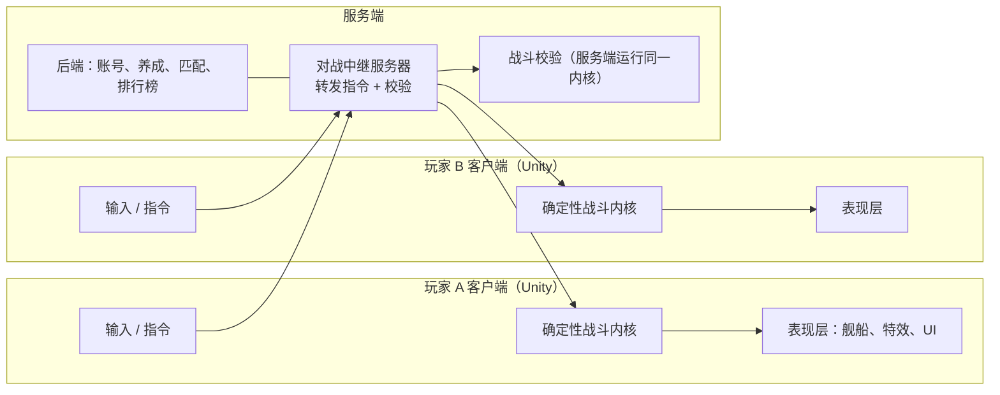

# 游戏设计文档（GDD）—— 太空舰队快速对战

> 版本：v0.1（草案）
> 日期：2026-10-18
> 项目代号：XFramework（正式游戏名待定）
> 状态：讨论稿，第 12 节列出了待确认事项

---

## 1. 一句话概述

**收集和改装宇宙舰船，组建自己的舰队，与其他玩家进行 3 分钟一局的实时太空对战。** 战斗中要管好补给、利用威慑，并像简化版《红色警戒》一样快速框选舰船下达指令。

### 1.1 核心体验

| 关键词 | 含义 |
|---|---|
| **快** | 一局 3 分钟左右，打开就能玩一局 |
| **爽** | 舰队交火、跃迁突袭、旗舰爆炸的视觉冲击 |
| **策略** | 布阵、克制、补给线、威慑的取舍，而不是比谁手快 |
| **收集** | 不断获得新舰船、新改装模块，打造自己风格的舰队 |

### 1.2 参考游戏

| 游戏 | 借鉴点 |
|---|---|
| 皇室战争 | 卡牌收集与升级、短局实时对战、资源随时间恢复 |
| Mechabellum | 先布阵后交战、兵种克制、局内升级 |
| 红色警戒 / 星际争霸 | 框选单位、快捷指令的操作手感 |
| 家园（Homeworld） | 太空舰队战的视觉风格与舰种层次 |

### 1.3 目标平台

- **第一阶段：PC（Steam）**。鼠标框选和快捷键操作手感最好。
- **第二阶段：手机**（iOS / Android），重新设计触屏操作。

---

## 2. 世界观（初版）

银河边缘发现了大量“虚空晶体”，这是一种可以驱动跃迁引擎的能源。三大势力为争夺晶矿星域爆发冲突。

| 阵营 | 风格 | 特点 | 代表舰船 |
|---|---|---|---|
| **星盟舰队** | 人类联合政府 | 重装甲、强护盾、火力集中，单舰强、数量少 | 堡垒级战列舰 |
| **蜂群意志** | 机械智能集群 | 大量廉价无人机、可自我修复、数量压制 | 母巢运载舰 |
| **虚空行者** | 神秘能量文明 | 隐形、跃迁突袭、高爆发、低耐久 | 相位刺客舰 |

> 世界观只服务于玩法，前期保持简单；阵营数量可以先做 2 个，第 3 个后续更新。

---

## 3. 一局对战流程

```
匹配成功
   ↓
【部署阶段】30 秒
  双方同时在己方半场放置舰船，互相看不到对方部署
   ↓
【交战阶段】150 秒
  舰船自动交战，玩家可框选舰船下达指令、跃迁增援、释放技能
   ↓
【加时阶段】最多 30 秒（若未分胜负）
  补给恢复速度翻倍，加快结束
   ↓
【结算】
```

### 3.1 胜负条件

1. **摧毁对方旗舰**：立即获胜。
2. **时间结束**：比较双方得分（剩余舰队价值加占领的补给站数量），高者获胜。
3. **投降**：开局 60 秒后可投降。

### 3.2 战场地图

- **2.5D 平面战场**：舰船在一个平面上移动，镜头是斜俯视角的三维画面。不做完全的三维空间机动，这样才能保证操作简单、节奏快。
- 地图大小保证双方舰队在开局 15 到 20 秒内接触。
- **地图元素**：

| 元素 | 效果 |
|---|---|
| 补给站 | 可占领，提高己方补给恢复速度 |
| 小行星带 | 提供掩护（受到伤害降低），但移动减速 |
| 星云 | 进入后不可被远距离发现，适合伏击 |
| 引力井 | 区域内舰船减速，跃迁无法进入 |

---

## 4. 舰船体系

### 4.1 舰种与克制关系

| 舰种 | 定位 | 克制 | 被克制 |
|---|---|---|---|
| **战机群** | 快速、成群，贴近攻击大型舰船 | 战列舰、航母 | 护卫舰（防空） |
| **护卫舰** | 便宜、灵活，带防空武器 | 战机群 | 驱逐舰 |
| **驱逐舰** | 鱼雷和导弹，高爆发 | 护卫舰、巡洋舰 | 战机群 |
| **巡洋舰** | 均衡，中坚力量 | 驱逐舰 | 战列舰 |
| **战列舰** | 重装甲、远程主炮，昂贵 | 巡洋舰、护卫舰 | 战机群 |
| **航母** | 自身弱，持续放出战机群 | 战列舰 | 驱逐舰 |
| **支援舰** | 补给、维修、护盾增强 | 无（辅助） | 所有攻击舰 |
| **旗舰** | 每局必带一艘，有专属技能；被摧毁即失败 | — | — |

设计目标：**没有万能的舰船**，玩家必须根据对手的部署调整策略。

### 4.2 舰船属性

| 属性 | 说明 |
|---|---|
| 结构值 | 归零即被摧毁 |
| 护盾 | 先于结构值承受伤害，脱离交战后恢复 |
| 武器 | 类型（动能 / 能量 / 导弹 / 战机）、射程、伤害、射速 |
| 速度 | 移动和转向速度 |
| 指挥点 | 编入舰队的占用值（见 6.2） |
| 部署费用 | 战斗中跃迁增援所需的补给点数 |
| 主动技能 | 例如护盾过载、短距跃迁、集束鱼雷 |

### 4.3 稀有度

普通 → 稀有 → 史诗 → 传说。稀有度越高，**技能越特殊**，但基础数值不会碾压低稀有度，保证低稀有度舰船在后期依然有用。

---

## 5. 局内核心机制

### 5.1 操作与指令

指令保持精简，保证节奏快：

| 指令 | 操作（PC） | 说明 |
|---|---|---|
| 选中 | 左键点击 / 框选 | 支持 Ctrl + 数字编组、数字键快速选组 |
| 移动 | 右键点击空地 | 舰船沿途遇敌会自动开火 |
| 集火 | 右键点击敌舰 | 所选舰船优先攻击该目标 |
| 撤退 | 快捷键 R | 退回己方补给范围内，期间受到伤害降低 |
| 技能 | 快捷键 Q / W / E | 释放所选舰船的主动技能 |
| 跃迁增援 | 拖动舰船卡到战场 | 消耗补给点数，只能跃迁到己方控制区域 |

**不操作也能打**：舰船有自动战斗 AI，玩家的操作是“锦上添花”的战术调整，而不是必须的手速比拼。

### 5.2 补给

补给是区别于同类游戏的核心机制之一。

**补给点数（局内资源）**

- 每秒自动恢复，有上限。
- 用于跃迁增援、释放部分技能。
- 占领地图上的补给站可以提高恢复速度。

**补给范围（空间限制）**

- 己方母港、补给站、支援舰周围有**补给范围**。
- 舰船在补给范围内：护盾正常恢复，弹药充足。
- 舰船离开补给范围过久：
  - 导弹、鱼雷类武器**弹药逐渐耗尽**
  - 护盾**停止恢复**
- 因此，**深入敌后突袭有风险**，**击毁敌方支援舰、夺取补给站**能有效削弱对手。

### 5.3 威慑

**局内威慑值**

- 根据双方**场上舰队价值的对比**实时计算。
- 当一方的舰队价值超过对方一定比例（例如 1.5 倍）时，对方进入**被威慑状态**：
  - 射速下降 10%
  - 占领补给站速度下降
- **打破威慑**：弱势一方击毁对方高价值舰船（战列舰、航母）时，获得一次“士气爆发”：短时间内伤害提升，同时清除被威慑状态。

这样，“兵力越强，威慑越大”成立，但弱势方依然有翻盘手段，不会一边倒。

**账号威慑等级（局外展示）**

- 根据玩家拥有和培养的舰队总实力计算。
- **仅用于展示**：头衔、排行榜、对局开始时的入场特效。
- **不影响匹配，也不在天梯中提供数值加成**（见 7.3）。

---

## 6. 局外养成

### 6.1 收集

- 通过对战奖励、任务、赛季通行证获得**舰船卡**和**改装模块**。
- 重复获得的舰船卡转化为升级材料。

### 6.2 舰队编成

- 每支舰队包含：**1 艘旗舰 + 最多 8 张舰船卡**。
- **指挥点上限**：所有舰船的指挥点之和不能超过上限，防止全带最强舰船。
- 玩家可以保存多套舰队编成，开局前选择。

### 6.3 升级与改装

| 方式 | 效果 |
|---|---|
| **升级** | 提升舰船基础属性，有等级上限 |
| **改装模块** | 每艘舰船有 2 到 3 个插槽，可装武器、护盾、引擎类模块，改变玩法风格（例如把驱逐舰改成远程导弹型或近身鱼雷型） |
| **涂装** | 纯外观，不影响属性 |

**设计原则**：改装带来的是**玩法差异**，而不只是数值增长。

---

## 7. 游戏模式与匹配

### 7.1 模式

| 模式 | 说明 | 开放阶段 |
|---|---|---|
| **训练** | 对战 AI，教学与练习 | 首发 |
| **快速匹配** | 1v1，使用玩家实际养成等级 | 首发 |
| **天梯** | 1v1 排位，**等级标准化** | 首发 |
| **好友对战** | 邀请好友 1v1 | 首发 |
| 2v2 | 双人组队 | 后续更新 |
| 战役 | 单人剧情关卡 | 后续更新 |

### 7.2 匹配规则

- 按**隐藏的匹配分（ELO / Glicko 类）**匹配，而不是按战斗力或威慑等级匹配。
- 目标匹配时间小于 20 秒；超时后逐步放宽分数范围；新手前若干局可匹配 AI 对手。

### 7.3 公平性

- **天梯模式中舰船等级统一标准化**（例如全部按 9 级计算），比拼的是舰队搭配和操作。
- 养成的价值体现在：解锁更多舰船、更多改装组合、快速匹配中的数值体验、外观与展示。

---

## 8. 商业模式

**免费游玩 + 内购**，坚持“不卖数值优势（天梯中）”：

| 收入来源 | 内容 |
|---|---|
| 赛季通行证 | 每赛季的奖励路线，包含舰船、模块、涂装 |
| 外观 | 舰船涂装、跃迁特效、爆炸特效、旗舰皮肤 |
| 加速养成 | 资源礼包（不影响天梯公平性） |
| 买断版（可选） | Steam 上也可考虑低价买断 + 外观内购 |

**发行策略**：先上 **Steam 海外区** 验证玩法和留存。国内上线收费游戏需要版号，通常需要以公司名义申请，后续再评估。

---

## 9. 技术架构

### 9.1 总体结构



### 9.2 网络同步：确定性锁步

- 双方客户端**只发送玩家指令**（例如“第 120 帧，选中舰船 3、5，移动到 (x, y)”），不发送舰船状态。
- 中继服务器按逻辑帧收集双方指令，再统一广播。
- 双方客户端用**同一个确定性战斗内核**计算出完全相同的战斗结果。
- **防作弊**：服务端用同一内核重算对局，与客户端上报结果比对，不一致则判作弊。所有养成数据只存在服务端，客户端无法修改。

**确定性要求**（来自 [architecture.md](architecture.md) 的设计原则）：

- 战斗逻辑使用**定点数**计算，不使用浮点数（不同 CPU 和平台的浮点结果可能不一致）。
- 随机数使用固定种子的确定性随机数生成器。
- 逻辑帧率固定（例如 20 帧每秒），表现层独立插值到 60 帧以上。
- 战斗内核与 Unity 分离，作为纯 C# 类库，客户端和服务端共用。

### 9.3 技术选型（建议）

| 部分 | 选型 |
|---|---|
| 客户端 | Unity 6，URP 渲染管线 |
| 战斗内核 | 纯 C# 类库，定点数数学库 |
| 对战中继 | C# / .NET 8，基于 UDP 的可靠传输（如 KCP） |
| 后端服务 | ASP.NET Core + PostgreSQL + Redis |
| 部署 | 云服务器，按地区部署中继节点 |

### 9.4 代码仓库结构（建议）

```
XFramework/
├── docs/
├── src/
│   ├── XFramework.Battle/       确定性战斗内核（定点数、舰船、武器、补给、威慑）
│   ├── XFramework.Battle.Tests/ 确定性回归测试
│   ├── XFramework.Relay/        对战中继服务器
│   └── XFramework.Backend/      账号、养成、匹配
└── UnityClient/                 Unity 客户端
```

---

## 10. 美术与音效方向

- **风格化低多边形 / 卡通渲染**：成本可控，辨识度高，适合个人开发。
- **阵营配色鲜明**：星盟蓝白、蜂群橙黑、虚空紫色，一眼区分敌我和阵营。
- **重点投入**：武器开火、护盾受击、跃迁出现、旗舰爆炸，这些是“爽感”的主要来源。
- **战场背景**：星空、星云、行星作为远景，不需要复杂场景。
- 音效与音乐可先用商用素材库，后期再定制。

---

## 11. 开发路线图

| 阶段 | 目标 | 主要内容 | 验收标准 |
|---|---|---|---|
| **P0 玩法原型** | 验证好不好玩 | 3 种舰船、1 张地图、框选和移动 / 集火指令、对战简单 AI；先用方块和简单模型 | 自己和朋友试玩，一局 3 分钟内结束，觉得“想再来一局” |
| **P1 核心机制** | 补给与威慑 | 补给点数、补给范围、补给站、威慑值、技能 | 出现“切断补给翻盘”“打破威慑翻盘”的对局 |
| **P2 确定性内核** | 为联网做准备 | 战斗逻辑改为定点数、确定性随机数，录像回放 | 同一指令序列回放 100 次结果完全一致 |
| **P3 联网对战** | 1v1 实时对战 | 中继服务器、锁步同步、断线重连、简单匹配 | 两台不同电脑完整打完一局，无不同步 |
| **P4 养成系统** | 收集与升级 | 舰船卡、升级、改装模块、舰队编成、后端账号 | 新玩家完整体验“获得 → 升级 → 编队 → 对战” |
| **P5 内容扩充** | 可上线的内容量 | 2 个阵营、每阵营 10 艘以上舰船、3 张地图、美术替换 | 内容足够支撑 2 周以上的游玩 |
| **P6 测试上线** | Steam 发布 | Steam 页面、封闭测试（Playtest）、数据埋点 | 收集留存、对局时长、胜率等数据 |

**最重要的一条**：P0 完成后一定要找人试玩。玩法原型不好玩，后面的养成和联网都没有意义。

---

## 12. 待确认事项

| 编号 | 问题 | 当前假设 |
|---|---|---|
| Q1 | 首发平台 | PC（Steam） |
| Q2 | 一局时长 | 部署 30 秒 + 交战 150 秒 + 最多 30 秒加时 |
| Q3 | 威慑机制 | 局内威慑值影响战斗；账号威慑等级只用于展示 |
| Q4 | 首发阵营数量 | 2 个 |
| Q5 | 游戏正式名称 | 待定 |
| Q6 | 美术风格 | 风格化低多边形 / 卡通渲染 |
